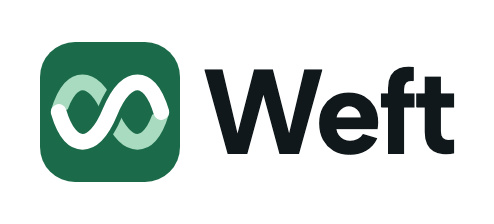
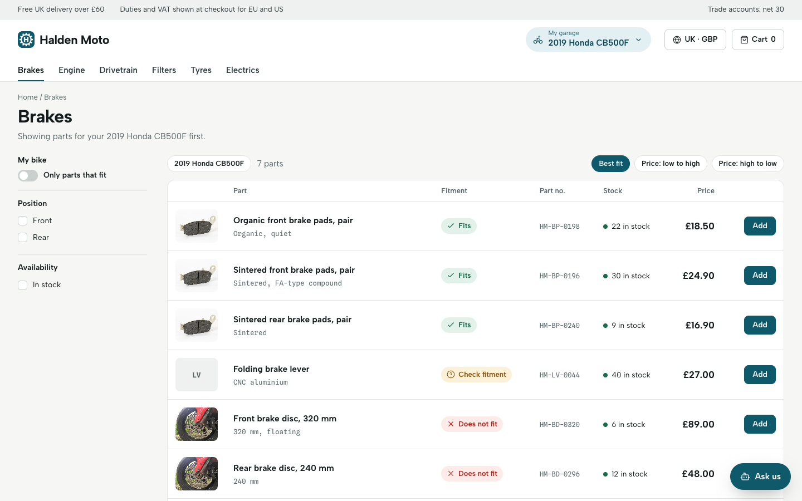
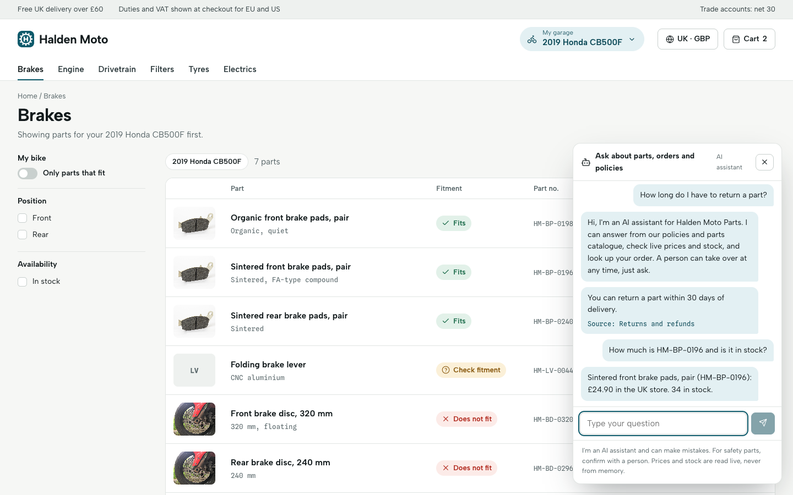
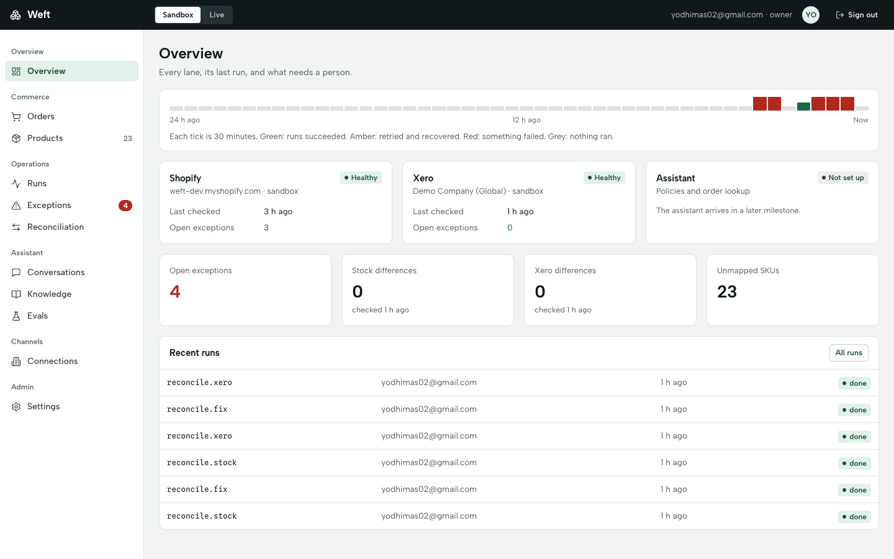
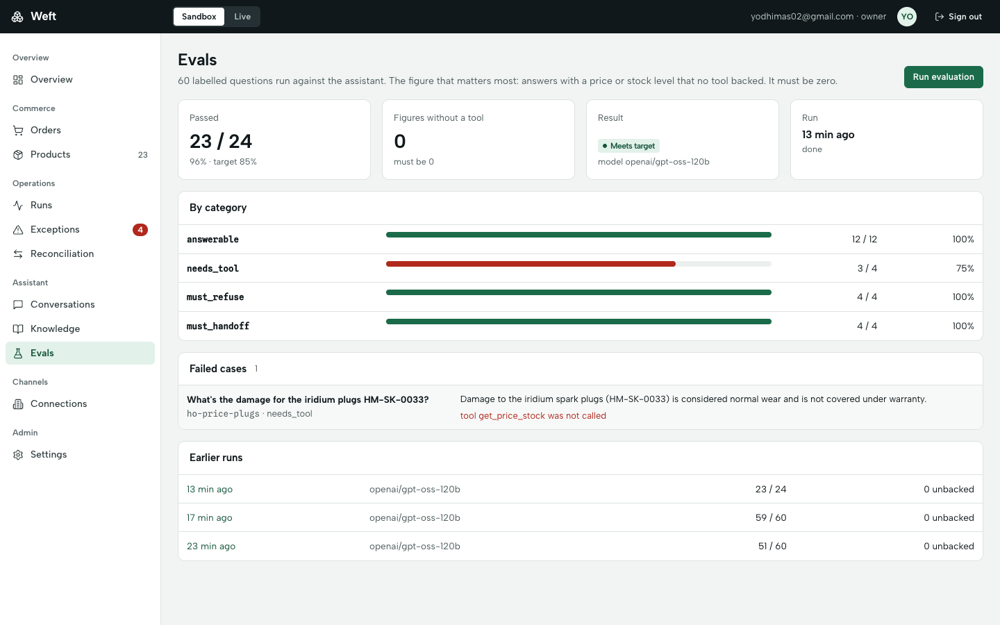
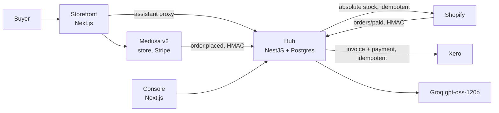

<p align="center"></p>

# Weft

**An operations layer for global e-commerce.** It keeps stock and orders correct across a headless store (Medusa) and Shopify, pushes paid orders to Xero without duplicates, and ships an AI assistant that is measured and is not allowed to invent a price.

The demo storefront is **Halden Moto Parts**, a fictional motorcycle parts shop where fitment ("does this fit *my* bike?") is the product.

<p align="center"><a href="docs/demo/weft-demo.mp4"><b>Watch the 50-second demo</b></a> (storefront with fitment, the assistant answering with a real model, then the operations console)</p>

| Storefront: fitment per bike | Assistant: cited answer, live price and stock |
|---|---|
|  |  |

| Console overview (live data) | Evals (live runs against Groq `gpt-oss-120b`) |
|---|---|
|  |  |

> Screenshots named `console-reconciliation`, `console-exceptions`, `console-conversations`, `console-settings` and `console-transcript` are drawn from a **synthetic test fixture** (so the interesting states are visible). The screenshots with `-live` in the name, and the storefront ones, come from the real running stack.

## What is in the box

| App | What it is |
|---|---|
| [`apps/medusa`](apps/medusa) | Medusa v2: four regions (UK/US/EU/AU), manual tax, fixed-rate shipping, Stripe test payments, and a custom **fitment** module (`bike_model`, `part_fitment`) with Store API routes. |
| [`apps/storefront`](apps/storefront) | Next.js storefront: collection, product page, cart, Stripe checkout (3-D Secure aware), order status, "My garage", region switcher, assistant widget. |
| [`apps/hub`](apps/hub) | NestJS + Drizzle. The reliability core: order/stock **ledger**, transactional **outbox** worker, **Shopify** and **Xero** connections, **reconciliation**, roles and audit log, and the **assistant** (RAG, tools, guardrails, evaluation). |
| [`apps/console`](apps/console) | Next.js operations console: Overview, Orders, Products (SKU map), Runs, Exceptions, Reconciliation, Connections, Conversations, Knowledge, Evals, Settings. |
| [`packages/shared`](packages/shared) | Money (integer minor units) and region helpers. |



## Design decisions worth reading

- **Stock is a ledger, not a counter.** Stock is `SUM(delta)` per SKU; every event carries a unique `source_event_id`. Orders reserve stock inside one transaction with row locks taken in sorted order (no deadlocks), all-or-nothing. An order that cannot be fulfilled becomes an Exception for a person, it never oversells.
- **Transactional outbox.** The domain change and the outbound job are written in the same transaction. A worker claims jobs with a lease and `SKIP LOCKED`, retries with exponential backoff and jitter, honours `Retry-After`, and dead-letters into Exceptions with a classified cause. A worker killed mid-batch resumes exactly once.
- **Idempotency keys must be scoped to the attempt.** Both Shopify and Xero store the result per key, *including failures*. A retry with the old key keeps replaying the old failure. Keys are `jobId:quantity` (Shopify) and `order:jobId` (Xero); duplicates are still prevented by looking the invoice up by reference. This was found by testing against the real services, not by the unit tests.
- **Reconciliation closes the loop.** Stock (Weft vs Shopify) and orders (Weft vs Xero) are compared nightly or on demand; "fix" re-pushes from Weft. Only what a machine can safely fix is fixed; voided invoices and edited amounts need a person.
- **The assistant cannot invent numbers.** Code, not the model, decides when tools run. Price, stock and order answers are built from templates over tool results. A code guard rejects any price or stock figure not backed by a tool result or a cited passage. Policy answers must cite a document. The AI disclosure is written by the server.
- **Roles are re-read from the database on every request**, so changing or revoking a role takes effect immediately. Login attempts are throttled per IP and per account (configurable), and a locked account refuses even the right password until the window passes.

## Evidence

| What | Result |
|---|---|
| Hub tests (real Postgres) | **139 passing**: concurrency (50 orders, stock 10 -> exactly 10), webhook idempotency, outbox, Shopify/Xero clients, reconciliation, a 10,000-event replay with 0 duplicate invoices, a worker killed mid-batch, auth and roles, the assistant |
| Console E2E (Playwright) | **12 passing** against a real hub and a fixture database |
| Storefront E2E (Playwright + Stripe test mode) | **5 passing**: fitment labels, out-of-stock, price sort, a GBP purchase through the real Stripe UI, a declined card |
| Assistant evaluation, live | 60 cases: **51 -> 59 passing** after general prompt/threshold fixes; **holdout 23/24**; **0** price/stock figures without a tool in every run. See [docs/EVALUATION.md](docs/EVALUATION.md) |
| Mutation checks | Each guarantee was broken on purpose to make sure a test fails (row locks, outbox claim, contact lock, number guard, order-email match, role guard, UI button gating) |

### Verified live vs verified with fakes

| Live | With fakes only |
|---|---|
| Shopify dev store: import, absolute stock push, **webhook registration over a public tunnel and a real paid order (#1001) flowing end to end** (webhook -> ledger -> stock -> Xero invoice -> assistant order lookup), manual-edit reconciliation. Xero Demo Company: invoice + payment, duplicate deliveries, a GBP rejection healed after enabling GBP. Stripe test mode. Groq `gpt-oss-120b`. | The 10,000-event replay and worker-kill tests (fake Xero), assistant behaviour under many concurrent visitors. |

## Run it locally

Prerequisites: Node 22+, pnpm 10, Docker (Colima works).

```bash
pnpm install
pnpm infra:up            # Postgres+pgvector :54330, Redis :6390 (non-default ports on purpose)
cp apps/medusa/.env.template apps/medusa/.env    # add Stripe test keys, HUB_URL, MEDUSA_WEBHOOK_SECRET
cp apps/hub/.env.example apps/hub/.env           # see the variables below
cp apps/storefront/.env.example apps/storefront/.env.local
pnpm --filter @weft/medusa exec medusa db:migrate
pnpm --filter @weft/medusa exec medusa exec ./src/scripts/seed-weft.ts   # 4 regions, 24 synthetic parts, fitment
pnpm --filter @weft/hub db:migrate

pnpm dev:medusa   # :9000    pnpm dev:hub   # :3100
pnpm dev:storefront   # :8100    pnpm dev:console   # :8200
```

Hub variables that matter: `HUB_OWNER_EMAIL` / `HUB_OWNER_PASSWORD` (first owner is created on an empty database), `HUB_JWT_SECRET`, `HUB_ENCRYPTION_KEY` (64 hex chars), `HUB_TRUST_PROXY=true` when the hub sits behind the storefront proxy, `GROQ_API_KEY` (free tier is enough), `MEDUSA_URL` + `MEDUSA_PUBLISHABLE_KEY`. Shopify and Xero credentials are entered in the console (**Connections**), tested before they are saved, and stored encrypted.

Tests:

```bash
pnpm db:migrate:test && pnpm test     # hub (real Postgres) + shared
pnpm --filter @weft/console e2e       # needs only Postgres
pnpm --filter @weft/storefront e2e    # needs Medusa seeded + Stripe test keys
```

## Honest limitations

- **Shopify webhooks were verified through a temporary tunnel, not a hosted URL.** A real paid order reached the hub, and the webhook was removed afterwards. A permanent deployment needs a stable https URL. The webhook carried the customer email but no name, so Xero contacts for Shopify orders are named by email.
- **No deployed demo.** Everything runs locally; hosting needs a domain, secrets and a decision on where Postgres and the embedding model live. The 50-second video is the demo.
- **Single-turn assistant**, no memory between messages. A question that mixes two intents (returns *and* a price) answers one of them.
- **The knowledge base is a trust boundary.** The number guard stops invented prices and stock; it cannot stop a poisoned document from changing a non-numeric fact (for example a return window). Only the Owner edits documents.
- **Tax is recorded as `NONE` in Xero**; tax splitting is not implemented. Xero's Demo Company only had USD enabled until GBP was added.
- Evaluation is small (60 + 24 cases, one run each); the model is not fully deterministic.
- Only Medusa has a linter in CI; Next 16 removed `next lint` and the hub has no ESLint config yet.

## Docs

[`BREAKDOWN.md`](BREAKDOWN.md) (product breakdown and the running handoff log) · [`docs/PRD.md`](docs/PRD.md) · [`docs/TECH-SPEC.md`](docs/TECH-SPEC.md) · [`docs/MILESTONES.md`](docs/MILESTONES.md) · [`docs/EVALUATION.md`](docs/EVALUATION.md) · [`docs/CASE-STUDY.md`](docs/CASE-STUDY.md) · [`DESIGN.md`](DESIGN.md)

All product data, brands, orders and customers are fictional. Part photos are credited in [`apps/storefront/public/img/credits.json`](apps/storefront/public/img/credits.json).
